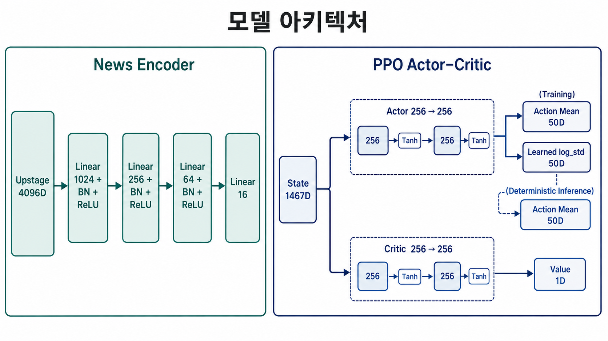
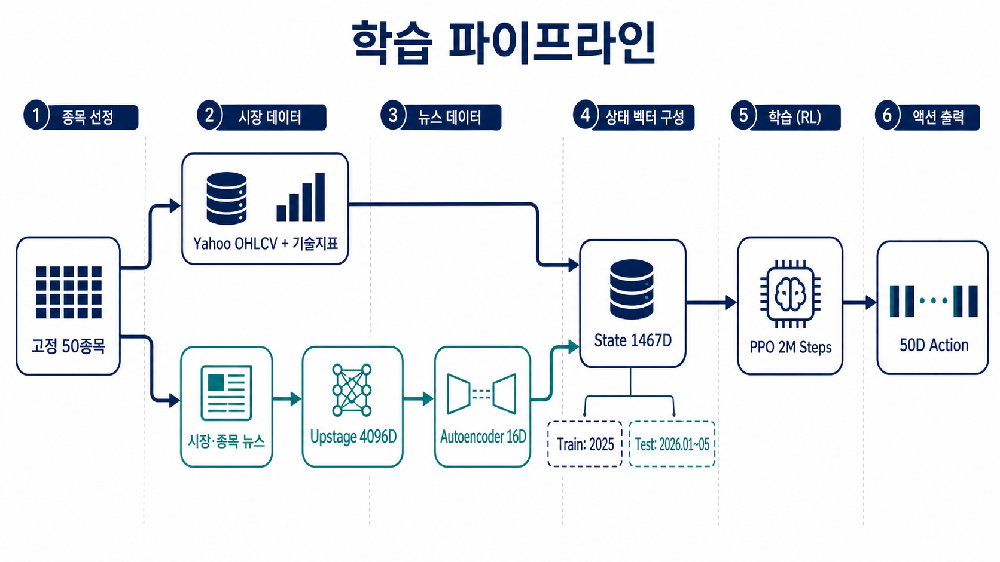
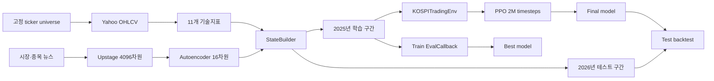
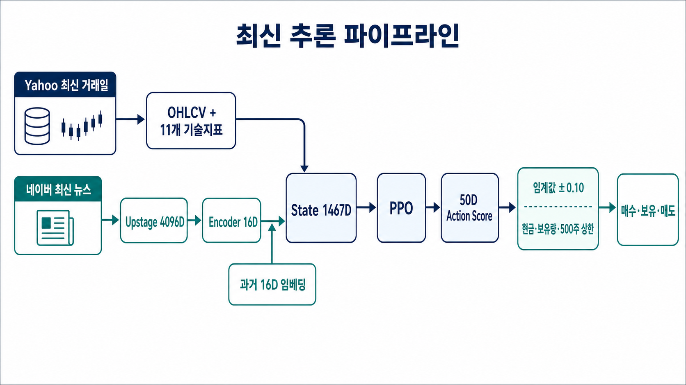
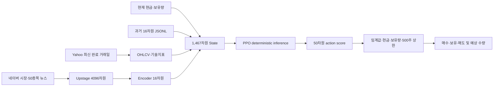

# 컨퍼런스 시연 및 기술 설명

이 문서는 RLFinanceAgent 데모의 시연 순서, 종목 universe와 추천 판정 기준, 학습·추론 파이프라인, 모델 구조를 설명함.

- 공개 데모: <https://rlfinanceagent-demo-330271913716.asia-northeast3.run.app>
- 용도: 연구용 의사결정 보조 데모
- 제외: 실제 주문, 수익 보장, 종목별 인과적 추천 사유 생성

## 1. 한 문장 소개

KOSPI 50종목의 가격·기술지표와 시장·종목 뉴스를 1,467차원 상태로 결합하고, PPO 정책이 종목별 연속 action score 50개를 출력하는 연구용 투자 에이전트임.

뉴스는 긍정·부정을 직접 분류하지 않음. Upstage 4,096차원 임베딩을 Autoencoder로 16차원에 압축한 의미 표현을 PPO 상태에 넣음. 따라서 뉴스 벡터는 명시적인 감성 점수라기보다 시장·종목 상황을 표현하는 잠재 특징임.

## 2. 컨퍼런스 시연 방법

### 시연 전 준비

1. 발표 10분 전에 공개 URL을 열어 cold start를 해소함.
2. 공유 데모 비밀번호를 입력해 로그인함. 인증 쿠키는 4시간 유지됨.
3. 첫 화면의 샘플 모드가 정상 완료되고 50종목 표가 표시되는지 확인함.
4. 최신 모드는 발표 직전에 한 번 실행해 성공 여부와 소요 시간을 확인함.
5. 최신 모드 실행 중에는 새로고침하거나 여러 브라우저에서 동시에 실행하지 않음.
6. 네이버·Yahoo·Upstage 외부 요청이 실패할 경우 샘플 모드로 설명을 이어감.

현재 Cloud Run은 `min instances=0`, `max instances=1`, `concurrency=1`임. 접속 가능한 사람이 한 명이라는 뜻은 아니지만 서버가 HTTP 요청을 한 번에 하나만 처리하므로, 긴 최신 추론 중 다른 요청은 대기하거나 실패할 수 있음.

### 권장 5분 시연 흐름

#### 1단계: 문제와 입력 설명

첫 화면에서 다음을 설명함.

- 기존 방식: 가격·기술지표 중심의 정량 상태
- 추가 정보: 시장 뉴스 16차원 + 50종목별 뉴스 각 16차원
- 출력: 50종목의 매수·보유·매도 점수와 제약을 반영한 예상 수량

#### 2단계: 샘플 모드

샘플 모드는 모델 ZIP에 저장된 실제 1,467차원 관측값을 재사용하므로 외부 API 없이 재현 가능함.

1. 모드를 `샘플 모드`로 유지함.
2. 시작 현금은 기본값 `10,000,000`원을 사용함.
3. 현재 보유 수량은 `{}`로 둠.
4. 화면 상단의 파이프라인 상태가 `정상`인지 확인함.
5. 매수·매도 상위 5개와 전체 50종목 표를 설명함.

샘플 모드에서 강조할 내용:

- 실제 저장된 PPO 관측값과 정책 출력을 사용함.
- 결과가 빠르고 외부 서비스 장애에 영향을 받지 않음.
- `모델 점수`는 확률이나 기대수익률이 아니라 PPO의 연속 action 값임.

#### 3단계: 포트폴리오 입력 변경

현재 보유 수량에 다음과 같이 입력하고 `모델 실행`을 누름.

```json
{
  "005930.KS": 10
}
```

이 입력은 삼성전자 10주를 이미 보유한 상황을 의미함. PPO action score 자체는 동일한 상태 입력에 의해 결정되고, 화면의 예상 주문 수량은 현금·현재 보유량·종목별 500주 상한·거래비용 0.3%를 적용해 다시 계산함.

#### 4단계: 최신 데이터 모드

1. 모드를 `최신 데이터`로 변경함.
2. `최신 뉴스 자동 수집`을 체크함.
3. 시작 현금과 보유 수량을 확인함.
4. `모델 실행`을 한 번 누르고 완료될 때까지 기다림.
5. 파이프라인의 네 단계를 순서대로 설명함.

```text
Yahoo 데이터 → Upstage → Autoencoder → PPO
```

정상 결과 예시:

- Yahoo 데이터: 최신 완료 거래일 표시
- Upstage: `최신 뉴스 N건 · 신규 임베딩` 또는 `임베딩 캐시`
- Autoencoder: `4096 → 16`
- PPO: `1,467 → 50`

최신 추론은 Yahoo 다운로드, 네이버 뉴스 수집, Upstage 호출을 포함하므로 1~3분이 걸릴 수 있음. 결과가 나올 때까지 재실행하지 않음.

#### 5단계: 결과 해석

- `score > 0.10`: 매수
- `-0.10 ≤ score ≤ 0.10`: 보유
- `score < -0.10`: 매도
- 예상 수량: `|score| × 500`을 기본값으로 계산한 후 현금·보유량·500주 상한을 적용함
- 예상 금액: t일 종가 기준이며 실제 체결 가격이 아님

발표에서는 “삼성전자를 사야 하는 이유가 특정 뉴스 한 건 때문”이라고 설명하지 않음. 현재 모델은 feature attribution이나 자연어 추천 사유를 생성하지 않음.

### 장애 시 대응

| 증상 | 대응 |
| --- | --- |
| 첫 접속이 느림 | cold start이므로 기다린 후 한 번만 새로고침함 |
| 최신 추론이 오래 걸림 | 중복 실행하지 않고 최대 3분 기다림 |
| `자동 수집 실패` 표시 | 네이버 차단 또는 검색 실패이며 기존 최신 임베딩 fallback 결과임을 설명함 |
| 최신 모드 오류 | 샘플 모드로 전환해 모델 구조와 저장 관측값 결과를 시연함 |
| 여러 사람이 동시에 접속 | 발표 화면 한 곳에서만 최신 추론을 실행함 |

## 3. 종목 선정과 추천 판정 근거

### 고정 50종목 universe

데모의 50종목은 추론 시 새로 선별되는 종목이 아님. 학습된 PPO의 action index 0~49와 일치하도록 고정된 universe임. 정확한 순서는 [`best_model_action_tickers.txt`](../backend/artifacts/best_model_action_tickers.txt)에 저장돼 있음.

환경은 학습 데이터의 ticker를 문자열 순으로 정렬해 action index를 만들었음. 데모는 이 순서를 별도 artifact로 고정해 잘못된 종목에 action이 매핑되는 것을 방지함.

현재 저장소에는 이 50종목을 시가총액, 거래대금, 업종 비중 등의 규칙으로 최초 선정한 실행 스크립트나 manifest가 없음. 따라서 다음과 같이 설명해야 함.

- 확인 가능한 근거: 해당 PPO 체크포인트가 학습한 고정 50종목과 action 순서
- 확인할 수 없는 근거: 최초 50종목을 구성한 경제적 스크리닝 기준
- 해서는 안 되는 주장: “시가총액 상위 50”, “유동성 상위 50”, “모델이 전체 KOSPI에서 선택한 50종목”

재현 가능한 universe 선정이 필요하면 별도 manifest에 기준일, 전체 후보군, 필터 조건, 선정 결과를 저장해야 함.

### 매수·보유·매도 선정 근거

PPO는 각 종목에 대해 `[-1, 1]` 범위의 action score를 출력함. 이 값은 다음 상태를 입력받은 신경망 정책의 결정값임.

- 현재 현금 비율
- 50종목 보유 수량
- 50종목 가격
- 50종목의 11개 기술지표
- 50종목별 16차원 뉴스 벡터
- 시장 공통 16차원 뉴스 벡터

상위 매수와 상위 매도는 이 score를 정렬한 결과임. score는 다음이 아님.

- 상승·하락 확률
- 예상 수익률
- 모델 신뢰도
- 뉴스 감성 점수
- 특정 feature의 인과적 기여도

모델은 학습 기간 동안 포트폴리오 일간 수익률을 reward로 받아 누적 보상을 높이는 방향으로 정책을 업데이트했음. 따라서 개별 종목 추천의 근거는 “전체 1,467차원 상태에서 PPO가 학습한 정책 출력”까지 설명할 수 있고, 현재 구현만으로 그보다 세부적인 인과 설명은 제공할 수 없음.

## 4. 데이터와 State 구조

### 입력 데이터

| 구분 | 내용 |
| --- | --- |
| 가격 | Yahoo Finance 일별 OHLCV |
| 기술지표 | MACD, Bollinger 상·하단, RSI, CCI, DX, SMA 30·60, 거래량 변화, 1일·5일 수익률 |
| 시장 뉴스 | 날짜별 여러 기사의 16차원 벡터 평균 |
| 종목 뉴스 | 날짜·ticker별 여러 기사의 16차원 벡터 평균 |

뉴스가 없는 날짜는 종목별·시장별 직전 벡터를 forward-fill하고, 이전 값도 없으면 0으로 채움.

### 1,467차원 State

50종목 모델의 한 타임스텝 state는 다음과 같음.

| 구성 | 차원 |
| --- | ---: |
| 현금 / 포트폴리오 가치 | 1 |
| 보유 수량 / 500 | 50 |
| 종가 / 자본 프록시 | 50 |
| 기술지표 11개 × 50종목 | 550 |
| 종목 뉴스 16차원 × 50종목 | 800 |
| 시장 뉴스 16차원 | 16 |
| 합계 | 1,467 |

```text
1 + 50 + 50 + (11 × 50) + (16 × 50) + 16 = 1,467
```

기술지표 scaler는 `2025-01-01 ≤ date < 2026-01-01` 학습 구간에만 fit하고 이후 구간에는 transform만 적용함. 뉴스 잠재 벡터는 별도 표준화하지 않음.

## 5. 뉴스 임베딩과 Autoencoder

### 뉴스 입력 생성

- 시장 뉴스: `시장 뉴스 | 제목: ...`
- 종목 뉴스: `회사: 회사명 | 제목: ...`

Upstage `embedding-passage`가 기사별 4,096차원 벡터를 생성함. 이 벡터는 다음 encoder를 통과함.

```text
4096
  → Linear(4096, 1024) → BatchNorm → ReLU
  → Linear(1024, 256)  → BatchNorm → ReLU
  → Linear(256, 64)    → BatchNorm → ReLU
  → Linear(64, 16)
```

시장 기사는 날짜별 평균, 종목 기사는 `(date, ticker)`별 평균으로 집계함. 시장 벡터는 50종목 모두에 공통으로 broadcast하고 종목 벡터는 해당 ticker에만 결합함.

현재 저장소에는 추론용 `encoder_dim16.pth`만 있고 decoder, Autoencoder 학습 스크립트, 학습 loss와 checkpoint 선정 기록은 없음. 따라서 4,096→16 encoder 추론은 재현할 수 있지만 Autoencoder 자체의 전체 학습 과정은 현재 저장소만으로 재현할 수 없음.

## 6. PPO 모델 아키텍처

저장된 체크포인트를 직접 로드해 확인한 구조임.



```text
State 1,467
   ├─ Actor:  Linear(1467, 256) → Tanh
   │          Linear(256, 256)  → Tanh
   │          Linear(256, 50)   → action mean
   │          학습 가능한 log_std 50개
   │
   └─ Critic: Linear(1467, 256) → Tanh
              Linear(256, 256)  → Tanh
              Linear(256, 1)    → state value
```

Actor와 Critic은 같은 1,467차원 입력을 받지만 MLP 가중치는 분리돼 있음. 추론에서는 `deterministic=True`를 사용하므로 확률분포에서 샘플링하지 않고 action mean을 사용함.

### 주요 PPO 설정

| 항목 | 값 |
| --- | ---: |
| 총 학습 timesteps | 2,000,000 |
| learning rate | 0.0003 |
| rollout `n_steps` | 2,048 |
| batch size | 64 |
| epoch | 10 |
| discount `gamma` | 0.99 |
| GAE lambda | 0.95 |
| clip range | 0.2 |
| entropy coefficient | 0.0 |
| value coefficient | 0.5 |
| max gradient norm | 0.5 |

결과 디렉터리 이름에는 `seed27`이 포함돼 있지만 저장된 SB3 체크포인트의 `seed` 메타데이터는 `null`임. 디렉터리 이름만으로 완전한 seed 재현성을 주장하면 안 됨.

## 7. 학습 파이프라인





### 데이터 구간

- 전체 시작: `2025-01-01`
- 학습: `2025-01-01 ≤ date < 2026-01-01`
- 테스트: `2026-01-01 ≤ date ≤ 2026-05-18`
- 초기 자본: 10,000,000원
- 종목별 최대 보유: 500주
- 거래비용: 0.3%

### 환경과 Reward

한 타임스텝은 한 거래일임.

1. t일 state를 관측함.
2. t일 action을 `[-1, 1]`로 제한함.
3. 임계값 0.10을 적용해 매수·보유·매도로 변환함.
4. t일 종가로 주문을 체결함.
5. t+1일 가격으로 포트폴리오 가치를 계산함.
6. 일간 포트폴리오 수익률에 `1e-4`를 곱해 reward로 사용함.

현재 환경은 t일 종가를 state에서 관측하면서 같은 t일 종가로 체결함. 실제 시장에서는 종가 확인 후 같은 가격에 체결하기 어렵기 때문에 백테스트 현실성의 한계임.

### 모델 선택과 평가 한계

`EvalCallback`은 별도 validation 환경이 아니라 학습 데이터 환경을 사용해 best model을 선택함. 이후 2026년 테스트 구간에서 final model을 평가하지만, 데모는 `best_model.zip`을 로드함.

따라서 저장된 백테스트 수치는 다음처럼 표현해야 함.

- 가능: “고정된 과거 구간에서 실행한 연구용 백테스트 결과”
- 불가: “독립 validation으로 검증된 일반화 성능”
- 불가: “향후 수익률 보장” 또는 “실전 투자 정확도”

## 8. 최신 추론 파이프라인





### 최신 모드 처리 순서

1. Yahoo Finance에서 `2025-01-01`부터 최신 완료 거래일까지 50종목 데이터를 가져옴.
2. 장중이면 당일 미완료 데이터를 제외함.
3. 과거 16차원 시장·종목 임베딩을 로드함.
4. 자동 수집을 켰으면 해당 거래일의 네이버 뉴스를 수집함.
5. 시장 키워드와 회사명·허용 별칭이 제목에 확인되는 기사만 유지함.
6. 신규 기사를 Upstage 4,096차원으로 임베딩함.
7. 공용 encoder로 16차원에 압축함.
8. 과거 임베딩과 신규 임베딩을 합쳐 최신 날짜 state를 재구성함.
9. PPO를 deterministic 모드로 실행해 50개 action score를 생성함.
10. action score를 주문 제약에 적용해 화면 결과를 생성함.

자동 수집 뉴스와 임베딩은 `demo_app/backend/runtime/`에 캐시함. Cloud Run 인스턴스가 종료되면 이 캐시는 사라질 수 있으므로 재시작 후 같은 날짜에도 외부 요청과 Upstage 비용이 다시 발생할 수 있음.

### 샘플 모드와 최신 모드 비교

| 항목 | 샘플 모드 | 최신 모드 |
| --- | --- | --- |
| 가격·상태 | 모델 ZIP 저장 관측값 | Yahoo 최신 완료 거래일 |
| 뉴스 | 저장 임베딩 | 네이버 자동 수집 + 수동 입력 |
| Upstage 호출 | 없음 | 신규 뉴스가 있으면 호출 |
| 속도 | 빠름 | 1~3분 가능 |
| 재현성 | 높음 | 외부 데이터와 수집 성공 여부에 영향 |
| 발표 용도 | 안정적인 기본 시연 | 전체 파이프라인 시연 |

## 9. 발표 중 자주 나올 질문

### 왜 PPO를 사용했는가?

50종목의 매수·매도 강도를 동시에 연속값으로 출력해야 하므로 연속 action 공간을 직접 다루는 Actor-Critic 계열 PPO를 사용함. PPO의 clipping은 한 번의 업데이트에서 정책이 지나치게 크게 변하는 것을 제한함.

### 뉴스는 감성 분석인가?

아님. 감성 label로 학습한 classifier가 아니라 Upstage 의미 임베딩을 Autoencoder로 압축한 잠재 특징임. PPO가 과거 reward와 함께 이 특징을 사용했을 뿐, 각 차원이 긍정·부정을 직접 뜻하지 않음.

### 매수 score 1.0은 100% 상승 확률인가?

아님. action 공간 상한에 가까운 강한 매수 방향 출력이라는 뜻임. 확률, 기대수익률, 신뢰도로 해석하면 안 됨.

### 모델이 50종목을 직접 골랐는가?

아님. 50종목은 체크포인트에 고정된 입력·action universe이며 PPO는 그 안에서 매수·보유·매도 강도를 결정함.

### 추천 이유를 종목별로 설명할 수 있는가?

현재는 불가함. 정책은 전체 상태를 비선형 결합하지만 SHAP, feature attribution, counterfactual 분석이 연결돼 있지 않음. 중요도는 추가 분석할 수 있으나 인과관계로 해석하면 안 됨.

### 실전 투자에 바로 사용할 수 있는가?

아님. 독립 validation 부재, t일 종가 관측·체결 가정, 거래대금·슬리피지·호가창 미반영, 뉴스 수집 안정성, 종목 universe 선정 provenance 부족을 해결해야 함.

## 10. 관련 구현

- 사이트 소개: [`SITE_OVERVIEW.md`](SITE_OVERVIEW.md)
- 데모 API와 추론: [`backend/pipeline.py`](../backend/pipeline.py)
- FastAPI와 정적 파일 제공: [`backend/app.py`](../backend/app.py)
- PPO 학습: [`../../rl/trainer.py`](../../rl/trainer.py)
- Gym 환경: [`../../rl/env_kospi.py`](../../rl/env_kospi.py)
- State 구성: [`../../data/state_builder.py`](../../data/state_builder.py)
- 시장 데이터: [`../../data/market_data.py`](../../data/market_data.py)
- 최신 뉴스 수집: [`../../news_crawler/README.md`](../../news_crawler/README.md)
- 배포 운영: [`../DEPLOYMENT.md`](../DEPLOYMENT.md)
