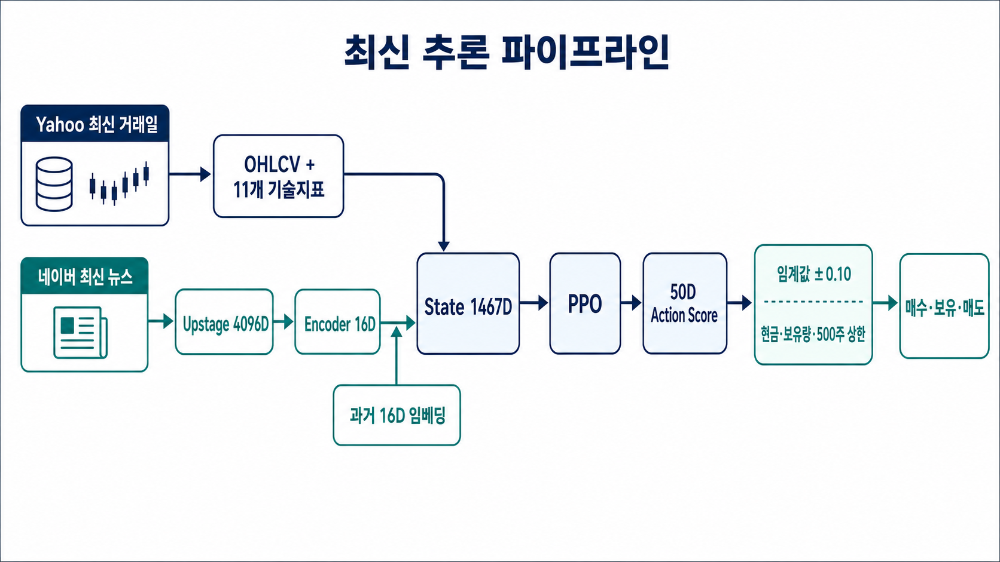

# FinRL Analyst Console 소개

## 이 사이트는 무엇인가?

FinRL Analyst Console은 가격·기술지표와 뉴스 데이터를 함께 사용하는 강화학습 투자 에이전트의 판단 과정을 보여주는 연구용 웹 데모임.

고정된 KOSPI 50종목을 대상으로 최신 시장 데이터와 뉴스를 하나의 상태로 구성하고, 학습된 PPO 모델이 종목별 매수·보유·매도 방향과 강도를 출력함. 실제 증권사 주문을 전송하지 않으며 투자 수익을 보장하지 않음.

- 공개 URL: <https://rlfinanceagent-demo-330271913716.asia-northeast3.run.app>
- 대상: 컨퍼런스 참가자, 연구자, 강화학습·금융 AI 파이프라인을 확인하려는 사용자
- 목적: 전체 데이터 흐름과 실제 PPO 추론 결과 시연



## 무엇을 보여주는가?

사이트는 다음 네 단계를 한 화면에서 확인할 수 있게 구성돼 있음.

1. Yahoo Finance에서 가격과 거래량을 가져와 기술지표를 계산함.
2. 시장 뉴스와 종목 뉴스를 Upstage로 임베딩함.
3. 4,096차원 뉴스 벡터를 공용 encoder로 16차원에 압축함.
4. 가격·기술지표·뉴스를 결합한 1,467차원 상태를 PPO에 넣어 50개 action score를 생성함.

상단 파이프라인 영역은 각 단계의 처리 상태와 실제 사용한 데이터 기준일을 표시함. 결과 영역은 매수·매도 상위 종목, 전체 행동 분포, 예상 현금, 50종목 전체 점수를 제공함.

결과 표의 `최근 수집 뉴스` 버튼은 서버에 캐시된 가장 최근 시장·종목 뉴스의 제목, 대상, 출처, 원문 링크를 표시함. Cloud Run 인스턴스가 종료되거나 재배포되면 runtime 캐시가 사라지므로 최신 데이터 모드를 다시 실행해야 함.

## 주요 기능

### 샘플 모드

모델 ZIP에 저장된 실제 관측값을 사용함. 외부 데이터 요청 없이 빠르게 동일한 PPO 출력을 재현하므로 발표 시작과 장애 대응에 적합함.

### 최신 데이터 모드

최신 완료 거래일의 Yahoo OHLCV와 해당 날짜의 네이버 시장·종목 뉴스를 사용함. 신규 뉴스가 있으면 Upstage와 encoder를 거쳐 최신 상태를 재구성함.

외부 요청이 포함되므로 샘플 모드보다 오래 걸리며, 뉴스 수집이 실패하면 기존 임베딩으로 fallback할 수 있음.

### 포트폴리오 입력

사용자가 시작 현금과 현재 보유 수량을 입력할 수 있음.

```json
{
  "005930.KS": 10
}
```

입력하지 않은 종목은 0주로 처리함. 예상 매수 수량은 매도 후 가용 현금을 양수 action score 비례로 분산하고, 보유량, 종목별 500주 상한, 거래비용 0.3%를 반영함.

`결과를 다음 입력으로 적용` 버튼은 예상 체결 후 보유 수량과 잔여 현금을 입력란에 자동 복사함. 같은 날짜에 재실행하면 동일한 시장 state에서 포트폴리오 state만 바꾼 재조정이며, 다음 거래일에 실행해야 시간 순서가 있는 연속 시뮬레이션이 됨.

### 뉴스 직접 입력

일반 텍스트는 줄마다 시장 뉴스로 처리함. JSON을 사용하면 시장 뉴스와 종목 뉴스를 구분할 수 있음.

```json
{
  "market_news": ["시장 뉴스 제목"],
  "stock_news": {
    "005930.KS": ["삼성전자 뉴스 제목"]
  }
}
```

자동 수집 뉴스와 직접 입력한 뉴스는 함께 사용됨.

## 결과를 어떻게 읽는가?

PPO는 각 종목에 `-1`부터 `1` 사이의 action score를 출력함.

| score | 표시 |
| --- | --- |
| `score > 0.10` | 매수 |
| `-0.10 ≤ score ≤ 0.10` | 보유 |
| `score < -0.10` | 매도 |

이 score는 상승 확률, 기대수익률, 신뢰도 또는 뉴스 감성 점수가 아님. 전체 1,467차원 상태에서 PPO 정책이 출력한 매매 방향과 강도임.

예상 수량과 예상 금액은 t일 종가 기준 계산값이며 실제 체결 결과가 아님. 비례 배분은 데모의 수량 후처리이고 PPO action score 자체는 그대로 표시함.

## 50종목은 어떻게 정해졌는가?

50종목은 사이트가 매번 전체 시장에서 새로 고르는 것이 아님. 현재 PPO 체크포인트가 학습한 action universe를 그대로 고정한 것임.

저장소에는 최초 universe를 시가총액·유동성 등의 규칙으로 선정한 실행 기록이 남아 있지 않으므로 “시가총액 상위 50종목”이라고 설명하면 안 됨. 사이트는 고정된 50종목 안에서 매수·보유·매도 score를 생성함.

## 접근 방식

사이트 화면은 공개 URL에서 열리지만 모델 실행은 공유 데모 비밀번호가 필요함. 비밀번호가 맞으면 브라우저에 4시간짜리 HttpOnly 인증 쿠키를 발급함. 비밀번호는 프론트엔드 코드가 아니라 Google Secret Manager에 저장함.

## 현재 운영 환경

- Frontend: React + Vite
- API: FastAPI
- Model: Stable-Baselines3 PPO
- Deployment: Google Cloud Run 서울 리전
- Runtime: 1 vCPU, 2GiB 메모리
- Autoscaling: minimum 0, maximum 1 instance
- Concurrency: 인스턴스당 요청 1개

트래픽이 없으면 인스턴스가 0개로 축소되므로 첫 접속에 cold start가 발생할 수 있음. 긴 최신 추론 중 다른 요청은 대기하거나 실패할 수 있음.

## 하지 않는 것

- 실제 주식 주문
- 투자 자문 또는 수익 보장
- 실시간 장중 주문
- 전체 KOSPI 종목의 동적 선별
- 종목별 자연어 추천 사유 생성
- 특정 뉴스와 매매 판단 사이의 인과관계 주장

## 한계

- 별도 validation set 없이 학습 데이터에서 best model을 선택함
- t일 종가를 관측하고 같은 t일 종가로 체결하는 백테스트 가정이 있음
- 슬리피지, 호가 잔량, 거래대금 제약을 충분히 반영하지 않음
- 뉴스 수집 결과가 네이버 검색과 외부 요청 상태에 영향을 받음
- 최초 50종목 universe 선정 provenance가 충분히 남아 있지 않음

따라서 현재 결과는 연구·시연용이며 실전 투자 판단으로 직접 사용하면 안 됨.

## 관련 문서

- 발표 순서와 상세 기술 설명: [`CONFERENCE_GUIDE.md`](CONFERENCE_GUIDE.md)
- 로컬 실행 방법: [`../README.md`](../README.md)
- 배포 운영: [`../DEPLOYMENT.md`](../DEPLOYMENT.md)
